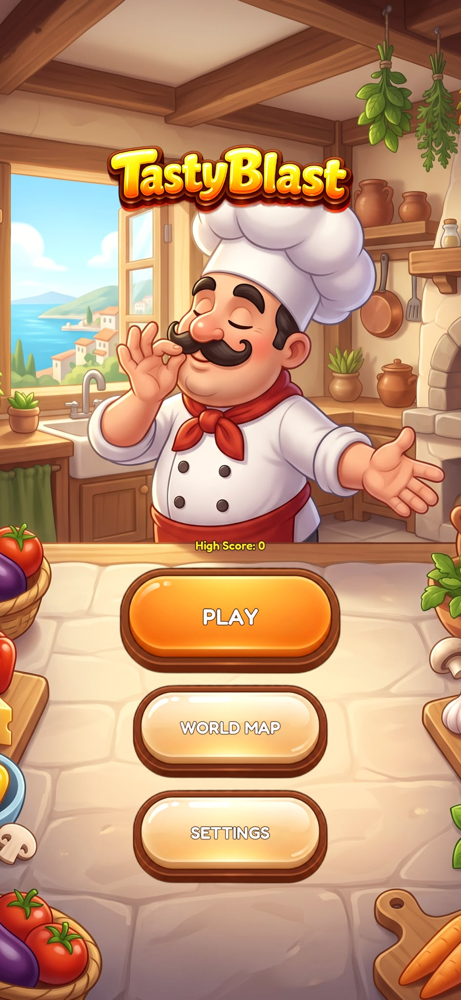
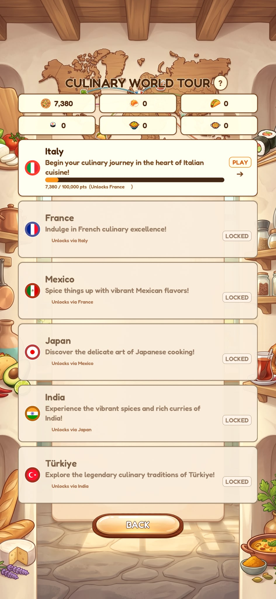
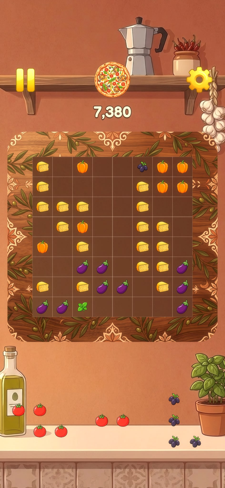
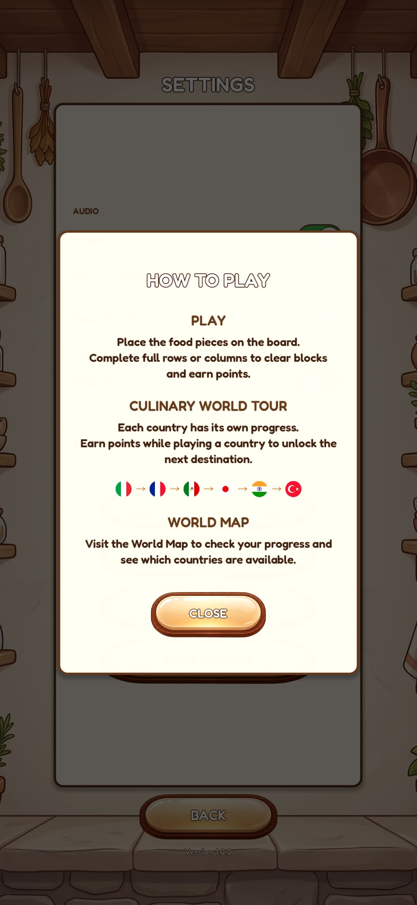
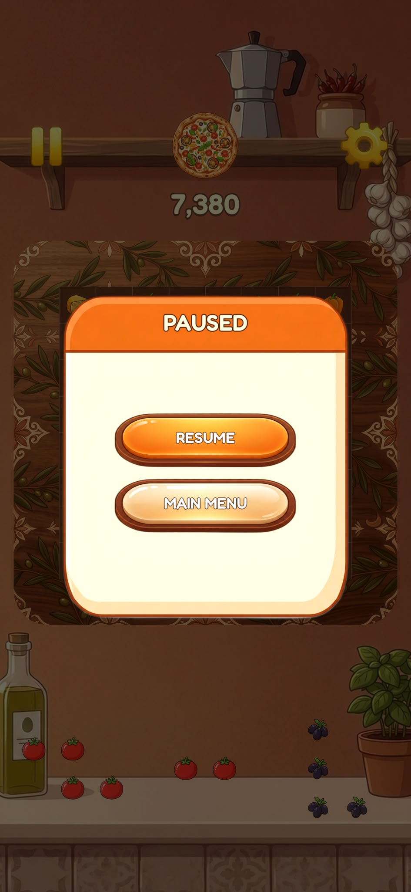
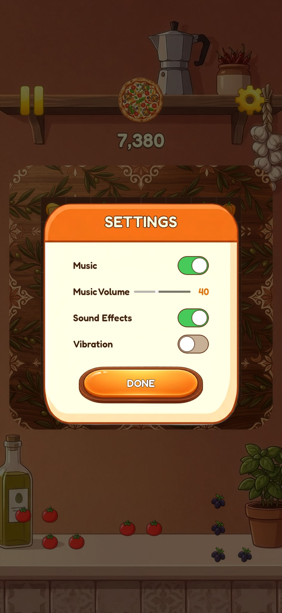
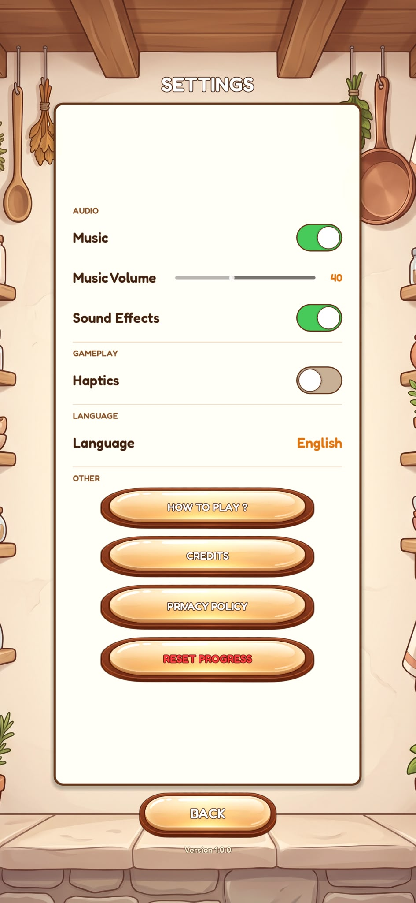
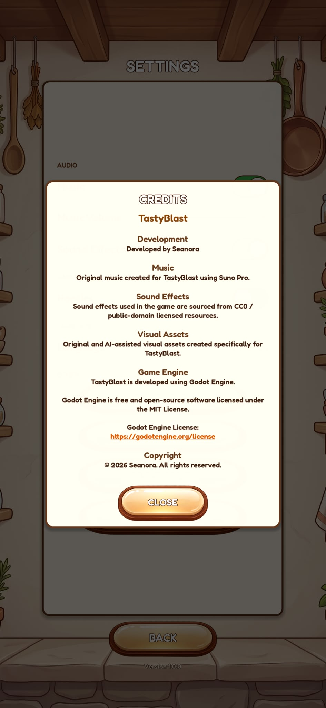

# TastyBlast

🇹🇷 [Türkçe](#türkçe) · 🇬🇧 [English](#english)

---

## Türkçe

**TastyBlast**, dünya mutfağı temalı, ızgara tabanlı bir blok temizleme bulmaca oyunudur. Godot 4.7 ile yapılmıştır, dikey (portre) mobil oyun olarak tasarlanmıştır (1080×1920).

### Ekran Görüntüleri

| | | |
|---|---|---|
|  |  |  |
|  |  |  |
|  |  | |

### Kurulum (Godot 4.7)

1. [godotengine.org](https://godotengine.org/download) adresinden Godot 4.7 sürümünü indirin.
2. Godot'yu açın, **Import** ile bu klasördeki `project.godot` dosyasını seçin.
3. Export için gerekli şablonları kurun: **Editor → Manage Export Templates → Download and Install**.
4. `export_presets.cfg.example` dosyasını `export_presets.cfg` olarak kopyalayıp kendi imza/kimlik bilgilerinizle düzenleyin (`export_presets.cfg` git'e eklenmez).

### Android Export

1. Android SDK ve JDK kurun, **Editor Settings → Export → Android** altında yollarını girin.
2. Kendi keystore dosyanızı oluşturun (repoya eklemeyin).
3. **Project → Export → Android** ön ayarını seçip keystore bilgilerini girin ve **Export Project** ile APK/AAB üretin.

### iOS Export ve Xcode ile Cihaza Kurulum

1. macOS ve Xcode gereklidir. Apple Developer hesabınızdaki Team ID ve Bundle Identifier değerlerini **Project → Export → iOS** ön ayarına girin.
2. **Export Project** ile bir Xcode projesi üretin.
3. Üretilen `.xcodeproj` dosyasını Xcode ile açın, **Signing & Capabilities** bölümünde Team seçin.
4. iPhone'u Mac'e bağlayın ve cihaz olarak seçip **Run (▶)** ile kurun.
5. **Geliştirici Modu:** iOS 16+ cihazlarda **Ayarlar → Gizlilik ve Güvenlik → Geliştirici Modu** seçeneğini açın ve cihazı yeniden başlatıp onaylayın.
6. İlk açılışta gerekirse **Ayarlar → Genel → VPN ve Aygıt Yönetimi** altından geliştirici profiline güvenin.

### Windows'ta Mac Olmadan iOS Derlemesi (xtool)

[**xtool**](https://github.com/xtool-org/xtool), Linux, WSL ve Windows üzerinde Mac kullanmadan iOS uygulaması derlemeyi, imzalamayı ve cihaza kurmayı sağlayan açık kaynaklı, çapraz platform bir Xcode alternatifidir. Kurulum rehberi: [Linux/Windows](https://xtool.sh/documentation/xtooldocs/installation-linux) · [İlk uygulama eğitimi](https://xtool.sh/tutorials/xtooldocs/first-app)

> [!NOTE]
> xtool, **SwiftPM** paketlerini iOS uygulamasına dönüştürür. Godot'nun ürettiği Xcode (`.xcodeproj`) projesini doğrudan derlemez. Bu yüzden xtool, bu projenin resmi derleme yolu değildir. Godot projesinin iOS çıktısını Mac olmadan almak için xtool ile uyumlu bir SwiftPM sarmalayıcı hazırlamanız gerekir. Bu yöntem deneyseldir ve bu depoda test edilmemiştir.

Genel akış:

1. xtool'u kurun (Windows'ta WSL üzerinden) ve rehberdeki adımlarla Swift araç zincirini ve iOS SDK'sını hazırlayın. SDK için Apple'dan Xcode paketini indirmeniz gerekir.
2. Apple ID ile giriş yapın (`xtool auth login`).
3. Projeyi derleyip cihaza kurun (`xtool dev run`). iPhone'un USB ile bağlı ve **Geliştirici Modu**'nun açık olması gerekir.

Komutlar ve adımlar sürüme göre değişebilir. Güncel bilgi için [xtool belgelerine](https://xtool.sh) bakın.

### Kaynaktan Derleme Notu

Depoda derlenmiş çıktı bulunmaz. Oyunu kaynaktan çalıştırmak için projeyi Godot 4.7'de açıp **F5** tuşuna basın. Export çıktıları (`export/`), kişisel veriler (`.godot-user/`), `export_presets.cfg` ve `_unnecessary_for_app_store/` bilerek git dışında tutulur; bu yüzden mağaza sürümü için export ön ayarlarını kendiniz oluşturmalısınız.

### Credits

- **Ses ve müzik:** Suno Pro ile üretilmiştir.
- **Görseller:** Nano Banana ile üretilmiştir.
- **Geliştirici:** Hikmet Bozkurt Aydoğan

### Lisans

- **Kod:** MIT Lisansı.
- **`assets/` altındaki görsel ve sesler:** CC BY-NC 4.0 (ticari kullanım yasaktır).

Ayrıntılar için [LICENSE](LICENSE) dosyasına bakın.

---

## English

**TastyBlast** is a grid-based block-clearing puzzle game with a world-cuisine theme. It is built with Godot 4.7 and designed as a portrait mobile game (1080×1920).

### Screenshots

| | | |
|---|---|---|
|  |  |  |
|  |  |  |
|  |  | |

### Setup (Godot 4.7)

1. Download Godot 4.7 from [godotengine.org](https://godotengine.org/download).
2. Open Godot, click **Import** and select `project.godot` in this folder.
3. Install export templates: **Editor → Manage Export Templates → Download and Install**.
4. Copy `export_presets.cfg.example` to `export_presets.cfg` and fill in your own signing/identity values (`export_presets.cfg` is git-ignored).

### Android Export

1. Install the Android SDK and a JDK, then set their paths in **Editor Settings → Export → Android**.
2. Create your own keystore (never commit it).
3. Select **Project → Export → Android**, enter keystore details and click **Export Project** to produce an APK/AAB.

### iOS Export and Installing on a Device via Xcode

1. macOS and Xcode are required. Enter your Apple Developer Team ID and Bundle Identifier in the **Project → Export → iOS** preset.
2. Click **Export Project** to generate an Xcode project.
3. Open the generated `.xcodeproj` in Xcode and choose your Team under **Signing & Capabilities**.
4. Connect your iPhone to the Mac, select it as the run destination and press **Run (▶)**.
5. **Developer Mode:** on iOS 16+ enable **Settings → Privacy & Security → Developer Mode**, then restart and confirm.
6. On first launch you may need to trust your developer profile under **Settings → General → VPN & Device Management**.

### iOS Builds on Windows Without a Mac (xtool)

[**xtool**](https://github.com/xtool-org/xtool) is an open-source, cross-platform Xcode replacement that lets you build, sign and install iOS apps from Linux, WSL and Windows without a Mac. Installation guide: [Linux/Windows](https://xtool.sh/documentation/xtooldocs/installation-linux) · [First app tutorial](https://xtool.sh/tutorials/xtooldocs/first-app)

> [!NOTE]
> xtool turns **SwiftPM** packages into iOS apps. It does not directly build the Xcode (`.xcodeproj`) project exported by Godot, so it is not an official build path for this project. Producing the Godot iOS build without a Mac requires an xtool-compatible SwiftPM wrapper. This approach is experimental and untested in this repository.

General flow:

1. Install xtool (via WSL on Windows) and set up the Swift toolchain and iOS SDK following the guide. The SDK requires downloading Xcode's package from Apple.
2. Sign in with your Apple ID (`xtool auth login`).
3. Build and install on the device (`xtool dev run`). The iPhone must be connected over USB with **Developer Mode** enabled.

Commands and steps may change between versions; see the [xtool documentation](https://xtool.sh) for current details.

### Building from Source

No prebuilt binaries are included. To run from source, open the project in Godot 4.7 and press **F5**. Export output (`export/`), local user data (`.godot-user/`), `export_presets.cfg` and `_unnecessary_for_app_store/` are intentionally git-ignored, so you must create your own export presets for store builds.

### Credits

- **Audio and music:** generated with Suno Pro.
- **Images:** generated with Nano Banana.
- **Developer:** Hikmet Bozkurt Aydoğan

### License

- **Code:** MIT License.
- **Images and audio under `assets/`:** CC BY-NC 4.0 (non-commercial use only).

See [LICENSE](LICENSE) for details.
